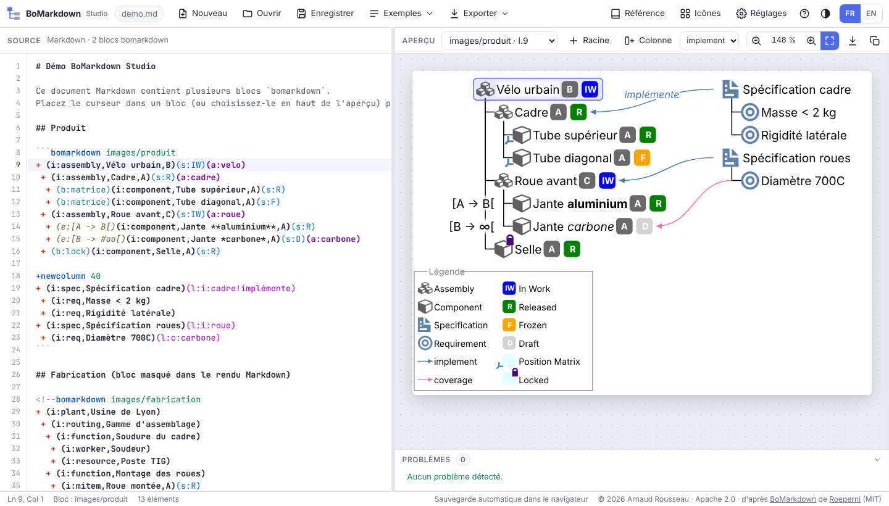
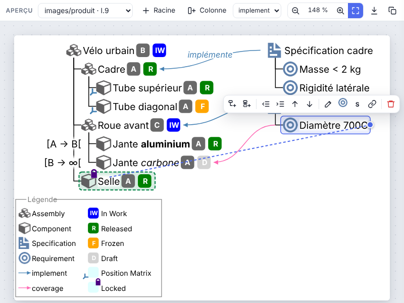

# BoMarkdown Studio

**Concevez vos nomenclatures (BOM) en texte, en graphique, ou les deux à la fois : écrivez quelques lignes ou
construisez l'arborescence à la souris, les deux vues restent toujours synchronisées.**



BoMarkdown Studio est un éditeur de nomenclatures qui tient dans **un seul fichier HTML**. Il offre deux façons
de concevoir la structure d'un produit (assemblages, composants, spécifications, exigences…), utilisables
ensemble à tout moment :

- **en texte**, avec une syntaxe courte et lisible, la coloration syntaxique et l'autocomplétion : idéal pour
  saisir vite, copier-coller, versionner dans Git ;
- **en graphique**, directement sur le diagramme : ajouter un enfant ou un frère, renommer, glisser un élément
  pour le déplacer, tirer un lien d'un élément à un autre, ajouter une colonne.

Chaque modification dans une vue apparaît aussitôt dans l'autre. Le diagramme affiche icônes par type, révisions,
statuts, effectivités, liens entre éléments et légende automatique, et s'exporte en SVG ou en PNG.

## Points forts

- **Conception textuelle et/ou graphique** : passez librement du clavier au diagramme, sans conversion ni
  perte. Le texte reste la source, donc tout s'annule avec `Ctrl+Z` et se relit facilement.
- **Rien à installer** : ouvrez `index.html` dans votre navigateur. Pas de serveur, pas de dépendance, fonctionne
  hors ligne.
- **Aperçu en direct** avec coloration syntaxique, autocomplétion et détection des erreurs.
- **Pensé pour la documentation** : un document Markdown peut contenir plusieurs diagrammes, et l'application
  exporte chacun d'eux et insère les liens image dans le texte.
- **Personnalisable** : vos propres icônes, statuts, bulles, types de liens et mise en page.
- **Interface en français ou en anglais**, thème clair ou sombre.

## Démarrer

1. Téléchargez `index.html` depuis la [dernière version](https://github.com/eowindel/bomarkdown-studio/releases/latest),
   ou clonez ce dépôt.
2. Ouvrez `index.html` dans un navigateur récent : Chrome, Edge, Firefox ou Safari.
3. Partez du document de démonstration, d'un exemple du menu **Exemples**, ou cliquez sur **Nouveau**.

Votre travail est **sauvegardé automatiquement** dans le navigateur. **Ouvrir** et **Enregistrer** permettent de
travailler sur des fichiers `.bmd` (une nomenclature seule) ou `.md` (un document Markdown).

## Concevoir en texte

### La hiérarchie

Chaque ligne qui commence par `+ ` est un élément. Le nombre d'espaces avant le `+` donne le niveau :

```text
+ Vélo
 + Cadre
  + Tube supérieur
 + Roue avant
```

Les lignes sans `+ ` sont ignorées : elles servent de commentaires.

### Décrire un élément

On complète une ligne avec des blocs entre parenthèses, dans n'importe quel ordre :

| Bloc | Rôle | Exemple |
|---|---|---|
| `(i:type,libellé,révision)` | Type (qui choisit l'icône), libellé et révision | `(i:component,Cadre,A)` |
| `(s:statut)` | Statut : `D` brouillon, `IW` en cours, `F` gelé, `R` validé, `O` obsolète | `(s:IW)` |
| `(a:alias)` | Nom court pour viser l'élément depuis un lien | `(a:cadre)` |
| `(l:type:alias1,alias2)` | Liens vers d'autres éléments (`i` implémente, `c` couvre, `a` alternative) | `(l:i:cadre)` |
| `(b:bulle1,bulle2)` | Pictogrammes sur l'icône (`lock`, `unlock`, `matrice`, `context`, `noway`) | `(b:lock)` |
| `(e:effectivité)` | Plage d'effectivité affichée à gauche, ou `o` pour une simple pastille | `(e:[A -> #oo[)` |

Quelques compléments :

- **Étiquettes de lien** : `(l:i:cadre!implémente)` place une étiquette sur le lien. `!<texte` la place au
  départ, `!>texte` à l'arrivée.
- **Mise en forme des libellés** : `*italique*`, `**gras**`, `***gras italique***`.
- **Symboles d'effectivité** : `->` devient →, `<-` devient ← et `#oo` devient ∞.

```text
+ (i:assembly,Vélo urbain,B)(s:IW)
 + (i:component,Cadre,A)(s:R)(a:cadre)(b:matrice)
 + (e:[A -> #oo[)(i:component,Roue *carbone*,C)(s:F)
```

### Plusieurs colonnes

`+newcolumn` commence une nouvelle colonne, à droite de la précédente. Un nombre ajoute de l'espace, par
exemple `+newcolumn 40`. C'est pratique pour mettre côte à côte un produit et ses spécifications, reliés par des
liens :

```text
+ (i:assembly,Vélo)
 + (i:component,Cadre)(a:cadre)
+newcolumn 40
+ (i:spec,Spécification du cadre)(l:i:cadre)
 + (i:req,Masse < 2 kg)
```

### Réglages propres à un diagramme

En tête de diagramme, un bloc JSON entre `${{` et `}}$` modifie l'affichage de ce diagramme seulement :

```text
${{
  "haslegend": false,
  "bend": 0.5
}}$
+ (i:assembly,Vélo)
```

### Plusieurs diagrammes dans un document Markdown

Dans un fichier `.md`, chaque diagramme est un bloc `bomarkdown`. Le chemin qui suit nomme l'image exportée :

````markdown
```bomarkdown images/velo
+ (i:assembly,Vélo)
 + (i:component,Cadre)
```

<!--bomarkdown images/fabrication
+ (i:plant,Usine)
-->
````

La première forme reste visible dans le Markdown. La seconde, en commentaire, est masquée dans le rendu du
document : on n'y voit que l'image. Placez le curseur dans un bloc, ou choisissez-le en haut de l'aperçu, pour
l'afficher.

## Concevoir en graphique

Tout ce qui s'écrit en texte peut aussi se faire directement sur le diagramme, et l'on peut alterner à volonté.
Cliquez sur un élément : une barre d'actions apparaît. Chaque action met le texte à jour en même temps, et tout
s'annule avec `Ctrl+Z`.



| Pour… | Faites… |
|---|---|
| Ajouter un enfant | `Tab` ou le bouton *enfant*, puis tapez son nom |
| Ajouter un élément au même niveau | `Entrée` |
| Renommer | Double-clic ou `F2` |
| Changer de niveau | `Alt+→` / `Alt+←` : toute la branche suit |
| Réordonner | `Alt+↑` / `Alt+↓` |
| Changer de parent | Glisser l'élément sur son nouveau parent (avec `Maj` : le placer juste après) |
| Créer un lien | Glisser la **poignée bleue** de l'élément vers la cible, ou `L` puis clic sur la cible |
| Modifier ou supprimer un lien | Cliquer sur le lien |
| Choisir le type ou le statut | Boutons de la barre, ou touches `T` et `S` |
| Supprimer un élément et ses enfants | `Suppr` |
| Ajouter une racine ou une colonne | Boutons **+ Racine** et **+ Colonne** en haut de l'aperçu (ou double-clic sur le fond) |

Les flèches du clavier déplacent la sélection : ← vers le parent, → vers le premier enfant. `Ctrl+clic` sur un
élément amène à sa ligne dans le texte.

## Exporter

Le menu **Exporter** propose :

- le diagramme courant en **SVG** ou en **PNG** (haute résolution), ou copié dans le presse-papiers ;
- tous les diagrammes d'un document d'un coup, dans un **dossier** (chacun écrit à son chemin, par exemple
  `images/velo.svg`) ou dans une archive **ZIP** ;
- **Insérer les liens image**, qui ajoute `` sous chaque bloc du
  document Markdown.

Les SVG produits sont autonomes, icônes comprises. Ils s'affichent tels quels dans GitHub, un wiki, une
documentation ou un traitement de texte.

## Personnaliser

- **Icônes** : glissez vos images (PNG, JPG, SVG, WebP) dans la bibliothèque. Le nom du fichier devient le nom du
  type : `moteur.png` s'utilise avec `(i:moteur,…)`. Les bibliothèques s'importent et s'exportent en JSON pour être
  partagées.
- **Types de liens** : un éditeur visuel (Réglages → *Types de liens*, ou le crayon à côté du choix du type de
  lien) permet de créer ses propres liens et d'en régler le code, le libellé, la couleur, l'épaisseur, le trait
  (continu, tirets, pointillés, tiret-point ou motif libre) et l'extrémité (flèche pleine ou ouverte, triangle
  creux, losange, rond, barre), éventuellement aux deux bouts, avec un aperçu immédiat.
- **Réglages** : dimensions et espacements, courbure des liens, légende, couleurs, fond transparent. Les statuts,
  bulles et règles de mise en forme se définissent en JSON. Les réglages s'exportent et s'importent.
- **Référence** : le panneau *Référence* liste tous les types, statuts, bulles et liens disponibles. Un clic les
  insère dans le texte.

## Raccourcis clavier

| Raccourci | Action |
|---|---|
| `Ctrl+Espace` | Autocomplétion (types, statuts, bulles, liens, alias) |
| `Tab` / `Maj+Tab` | Dans le texte : descendre ou remonter d'un niveau |
| `Entrée` | Dans le texte : nouvel élément au même niveau |
| `Ctrl+S` / `Ctrl+O` | Enregistrer / ouvrir |
| `Ctrl+Maj+E` | Exporter le diagramme courant en SVG |
| `Ctrl+molette` | Zoomer dans l'aperçu (glisser le fond pour se déplacer) |
| `F1` | Aide complète |

## Vos données

Tout reste sur votre poste. Le document en cours, vos réglages et vos icônes sont conservés dans le stockage du
navigateur ; rien n'est envoyé sur Internet.

Sous Chrome et Edge, **Enregistrer** réécrit directement le fichier ouvert, et l'export vers un dossier écrit les
images à leur place. Sous Firefox et Safari, l'enregistrement et les exports passent par des téléchargements.

## Signaler un problème, proposer une idée

BoMarkdown Studio en est à sa première version : vos retours sont précieux.
[Ouvrez une issue](https://github.com/eowindel/bomarkdown-studio/issues/new/choose) pour signaler un bug ou proposer
une amélioration, en français ou en anglais. Le bouton **Signaler un problème** de l'aide (`F1`) y mène aussi.
Indiquez la version affichée à côté du logo et, si possible, le texte BoMarkdown qui pose problème.

L'historique des versions est dans le [CHANGELOG](CHANGELOG.md).

## Licence et crédits

BoMarkdown Studio est © 2026 **Arnaud Rousseau**, distribué sous [licence Apache 2.0](LICENSE).
Vous pouvez l'utiliser, le modifier et le redistribuer, y compris à des fins commerciales, à condition :

- de conserver le fichier [`NOTICE`](NOTICE) et la mention de l'auteur dans toute redistribution ;
- d'indiquer les fichiers que vous avez modifiés.

La syntaxe BoMarkdown, les icônes par défaut et plusieurs exemples proviennent de l'extension VS Code
[BoMarkdown](https://github.com/Roeperni/bomarkdown) créée par **[Roeperni](https://github.com/Roeperni)** et ses
contributeurs, sous licence MIT ([`THIRD_PARTY_LICENSES`](THIRD_PARTY_LICENSES)). Merci à eux !
